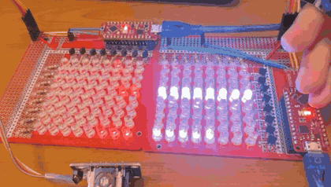
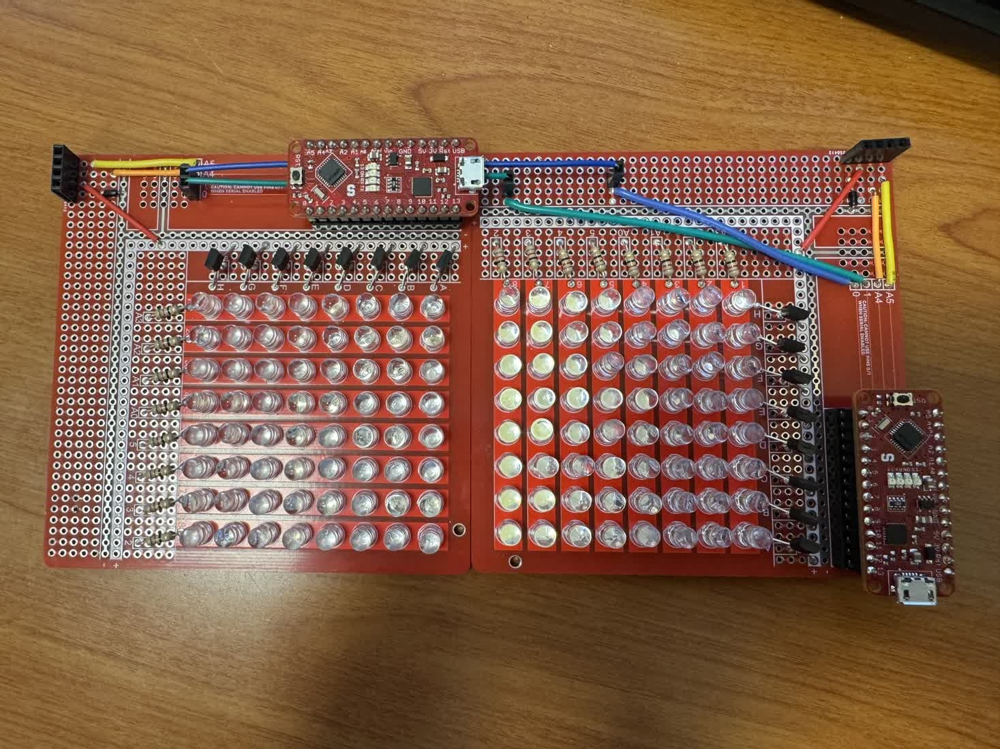
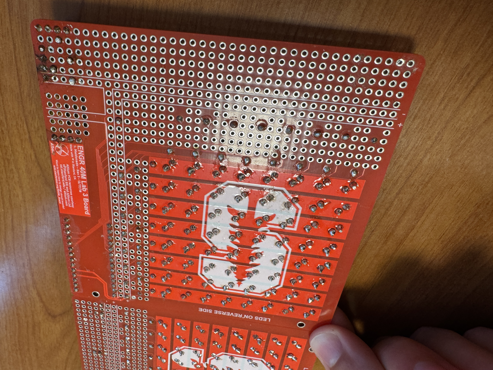

# Tron

Two-player Tron game made with two Arduinos. Each board drives its own 8×8 LED matrix, and
the two halves communicate to act as one 16×8 arena allowing the bikes to cross the seam and
the borders to wrap on all sides of the arena.





Built for ENGR 40M at Stanford.

## How it works

There is only one sketch which is flashed to both boards. The only difference between them is a flag at the top.

```c
#define IS_HOST true   // left host board
#define IS_HOST false  // right client board
```

The host owns the entire game and reads its own joystick, receives the other
board's joystick over serial, steps both bikes, resolves crashes, and keeps
score. The client draws the game state sent by the host and sends its analog input
to the host. Since everything is only computed on one board, the two halves never
disagree about where a bike is.

### The link

The two Arduinos communicate over serial at 115200 baud.

**Host → client**, a 41-byte state packet behind a `0xFF` start
byte.

| bytes | contents |
|---|---|
| 0 | phase (lobby, countdown, playing, crashed, game over) |
| 1 | death flags, both players packed into one byte |
| 2–5 | both head positions |
| 6–7 | both scores |
| 8–39 | the whole 128-cell grid |
| 40 | checksum |

A cell can only ever be empty, trail A or trail B, so it fits in two bits meaning four
cells fit in a byte. This allows for the entire arena to be encoded in 32 bytes. The
checksum is taken mod 128 so that it can never itself look like the `0xFF` start byte.

**Client → host**, a direction behind a `0xFE` start byte.

Neither side sends packets when the serial buffer is busy. This prevents the display refresh
from being stalled which would interfere with the time multiplexing and dim the lights. Also,
the host must send packets consistently because the client board blinks the LEDs along the seam
after 500 ms with no packet.

### Display

The matrices are multiplexed one row at a time. The variable brightness comes from splitting each
row's time slot into 15 slices and turning a given LED off partway through, so the two players'
trails can be at different brightnesses (15 and 5) and stay distinguishable on a single-color panel.
Additionally, the heads blink and the winner's trail pulses while the loser's goes dark.

### Game rules

- All edges on the display wrap connecting the two displays and allowing movement to opposite edges.
- Trails are stored in a ring buffer, starting at 8 cells and gaining one every 5 ticks, up to 16 cells long.
This ensures the rounds grow in intensity as they go on.
- Each tick is 3 ms faster than the last, starting at 250 ms down to a floor of 110 ms.
- Tails are freed *before* collisions are checked so chasing a tail that is
  moving away is legal. However heads are checked against the old grid, so swapping
  places kills both.
- First to 3 rounds wins the match. In the lobby phase, either player can hold their stick toward the
  other for one second to start. A progress bar LED indicator fills up along the seam.

## Hardware

- 2 × Stanford Metro Mini, based on the Adafruit Metro Mini board
- 2 × ENGR 40M Lab 3 board, each an 8×8 LED matrix hand-soldered on a PCB with pMOS transistors along the
rows and resistors along the columns
- 2 × analog joystick breakout on A4/A5
- Rows on pins 13–6, columns on A3–A0 and 5–2
- TX/RX crossed between the two boards

The matrix is built by hand on the course PCB. LEDs mount on the
reverse, so the side you solder is the side you never see:



## Flashing

Open `tron/tron.ino` in the Arduino IDE with the Arduino UNO selected as the board. Set `IS_HOST` to `true` when
flashing the left board and set it to `false` when flashing the right board.
